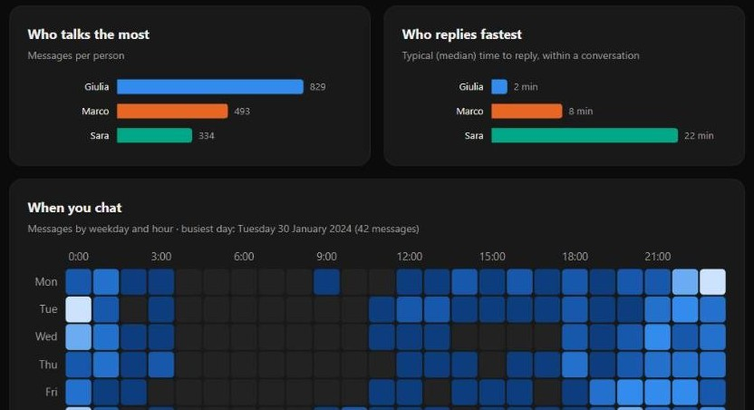

# WhatsApp Chat Analyzer

**Your chat, wrapped.** Stats, awards and charts for any WhatsApp chat, plus an optional AI recap from Claude or OpenAI.

### 👉 [Try it in your browser](https://k0m1d3v.github.io/WhatsApp-Chat-Analyzer/)

Drop your chat export on the page and that's it. The analysis runs entirely in your browser: the chat is never uploaded. There is also a command-line version (below).



- **100% local by default.** Without `--ai`, nothing leaves your computer.
- **Reads every export.** iPhone and Android, `.txt` or the `.zip` WhatsApp creates, any date format (day/month, month/day, 12h or 24h), multi-line messages.
- **Two modes.** `wrapped` covers the whole chat. `profile` covers one person: their numbers and, with AI, their communication style.

## What you get

| | |
|---|---|
| **Overview** | messages, words, days active, conversations, longest daily streak, longest silence |
| **Awards** | 💬 Chatterbox · 📜 Novelist · ⚡ Speed Demon · 🧊 Ice Breaker · 🦉 Night Owl · 👑 Emoji Royalty · 😂 Comedian · ❓ Curious Mind · 📸 Photographer |
| **Per person** | share of messages, words per message, typical reply time, conversations started, media, emojis, night messages, top emojis and words |
| **Charts** | who talks the most, who replies fastest, weekday × hour heatmap, messages per month |
| **AI recap** (optional) | the vibe of the chat, recurring topics and running jokes, memorable moments with dates, how each person shows up |
| **AI profile** (optional) | how one person writes, their tone and humor, how they engage, and tips for chatting with them |

The HTML report is a single file with no external resources. It works offline, follows light/dark mode and shows tooltips on hover.

## The website

[k0m1d3v.github.io/WhatsApp-Chat-Analyzer](https://k0m1d3v.github.io/WhatsApp-Chat-Analyzer/) has everything the command line has: Wrapped and Profile modes, time windows, the downloadable report.

- **No uploads.** The page is static (GitHub Pages) and reads your file locally, `.zip` exports included.
- **AI with your own key.** Paste an Anthropic or OpenAI API key and the request goes straight from your browser to that provider. The page's security policy only lets it connect to those two. The key stays in memory, or in your browser's storage if you tick *Remember my key*.

## Command line

### Install

```bash
git clone https://github.com/k0m1d3v/WhatsApp-Chat-Analyzer.git
cd WhatsApp-Chat-Analyzer
pip install .             # stats only
pip install ".[claude]"   # + Claude
pip install ".[openai]"   # + OpenAI
```

Needs Python 3.10+.

### Use

Export a chat from WhatsApp: open the chat → ⋮ / contact name → **Export chat** → **Without media**. Then:

```bash
wca wrapped "WhatsApp Chat - Friends.zip"
wca wrapped chat.txt --last 1y --open          # last year only, open the report in the browser
wca profile chat.txt --person "Sara"
```

Try it right away on the fictional sample chat:

```bash
wca wrapped examples/sample_chat.txt --open
```

#### With AI

```bash
export ANTHROPIC_API_KEY=...        # PowerShell: $Env:ANTHROPIC_API_KEY="..."
wca wrapped chat.zip --ai claude --anonymize

export OPENAI_API_KEY=...
wca profile chat.zip --person Sara --ai openai --lang Italian
```

Before sending anything, the tool tells you what will be sent and asks you to confirm (`-y` skips the question).

- `--anonymize` replaces every name with *Person A, B, …* and masks phone numbers, emails and links **before** the text leaves your computer. Real names are put back only in your local report.
- `--budget` limits how much of the chat is sent (the most recent messages first; default 150,000 characters). The stats always cover the whole chat.
- Claude uses `claude-opus-5-5` by default, OpenAI uses `gpt-4.1-mini`. Change the model with `--model`.
- For Claude, `--effort low|medium|high` sets how hard the model thinks. If Claude declines a request, it is retried automatically on another Claude model.
- The AI is told to describe how people *communicate*, never to diagnose them or to speculate about health, sexuality, religion or other sensitive topics.

> **Be fair to the people in the chat.** Analyze conversations you are part of, and only send them to an AI provider if the others would be OK with it.

#### All options

```
wca {wrapped,profile} CHAT [options]

time window   --last 30d|8w|6m|1y   counted back from the last message
              --since YYYY-MM-DD  --until YYYY-MM-DD
              --date-order dmy|mdy|ymd   (detected automatically)
output        --html FILE  --no-html  --open  --json FILE
AI            --ai claude|openai  --model M  --anonymize  --budget CHARS
              --lang LANGUAGE  --effort low|medium|high  -y
profile only  --person NAME   (asked interactively if missing)
```

## Development

```bash
pip install -e ".[dev,ai]"
pytest
python examples/make_sample.py   # regenerate the sample chat
```

| File | What it does |
|---|---|
| `wca/parser.py` | reads exports: formats, dates, multi-line messages, media/deleted/system lines |
| `wca/stats.py` | every number, conversations, reply times, streaks, awards |
| `wca/ai.py` | prompts, anonymization, Claude and OpenAI calls (structured JSON output) |
| `wca/terminal.py` | rich terminal output |
| `wca/report.py` | the HTML report with inline SVG charts |
| `wca/cli.py` | command line |
| `site/` | the website: the same parser, stats, report and AI ported to plain JavaScript (no build step) |

`tests/test_web_parity.py` runs the JavaScript version on the same chats (needs Node.js) and checks that every number matches the Python one. To try the site locally: `python -m http.server -d site`, then open http://localhost:8000.

## License

[MIT](LICENSE)
